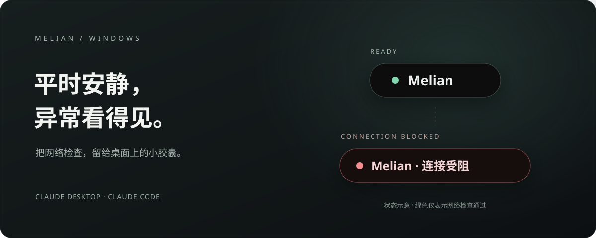
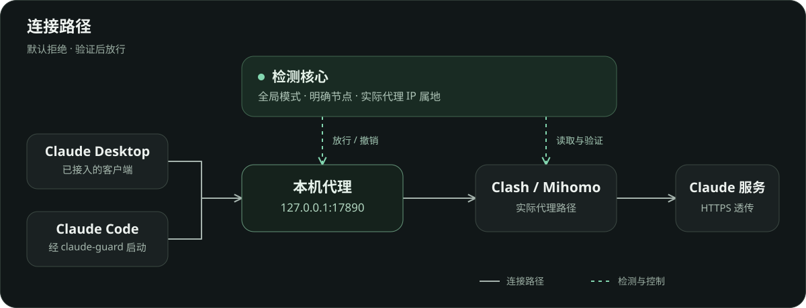

<div align="center">
  
  <h1>Melian</h1>
  <p><strong>一个小小的灵动岛，守住 Claude 的网络连接。</strong></p>
  <p>原生 Rust · 网络检查 · Codex 额度 · 静音可见提醒 · 登录自启</p>
  <p>
    
    
    <a href="LICENSE"></a>
  </p>
  <p><a href="#安装">安装</a> · <a href="#功能">功能</a> · <a href="#使用">使用</a> · <a href="#开发">开发</a> · <a href="https://github.com/JJchess/Melian/releases">下载</a> · <a href="https://github.com/JJchess/Melian/issues">反馈</a></p>
</div>



Melian 平时只留一个黑色胶囊，点击展开启动入口与自启开关。连接异常时显示原因，并断开已接入客户端的受保护网络。

它配合 Clash / Mihomo 工作：只有**全局模式、明确的代理节点、实际代理 IP 属地为美国**同时满足时才放行。Melian 本身不提供代理线路，也不改变账号地区。

## 安装

无需克隆仓库或安装开发工具。安装命令从 [GitHub Releases](https://github.com/JJchess/Melian/releases) 下载对应平台的程序，并验证 SHA-256。

**Windows 11 x64 — 在 PowerShell 粘贴一行：**

```powershell
irm https://raw.githubusercontent.com/JJchess/Melian/main/install.ps1 | iex
```

下载和校验完成后会打开安装器，确认安装即可。之后从桌面或开始菜单打开 **Melian**，日常使用不会打开 PowerShell。

**macOS 13+ — 在终端粘贴一行：**

```bash
curl -fsSL https://raw.githubusercontent.com/JJchess/Melian/main/install.sh | bash
```

自动识别 Apple 芯片或 Intel，安装到 `~/Applications/Melian.app`。新安装默认开启登录自启，可在胶囊菜单关闭；升级保留已有选择。Mac 的 Code 入口打开 Terminal，系统首次可能请求自动化授权。

也可直接下载 Release 附件。macOS 包使用 ad-hoc 签名，尚未提供 Apple Developer ID 签名与公证；详见 [macOS 指南](docs/MACOS.md)。

> **保护范围：** Windows 支持已接入的 Claude Desktop 与专用入口启动的 Claude Code；macOS 当前支持专用入口启动的 Claude Code，Desktop 接入尚未验证。自动网页保护暂时停用，两平台均不会接管普通浏览器或系统代理。绿色只表示网络检查通过。

## 功能

<table>
  <tr>
    <td width="33%"><strong>平时只占一点空间</strong><br /><br />黑色胶囊显示状态，点击展开。支持拖动、置顶与位置记忆；Windows 原生 Win32，Mac 原生 AppKit。</td>
    <td width="33%"><strong>检查通过才连接</strong><br /><br />验证模式、节点链与实际 IP 属地。检查失效时阻止新连接，同时关闭已有受保护连接。</td>
    <td width="33%"><strong>静音时也看得见</strong><br /><br />异常持续显示红色「连接受阻」，配合展开的原因提示，不依赖提示音。</td>
  </tr>
  <tr>
    <td><strong>终端与会话保留</strong><br /><br />通过专用入口启动 Claude Code。异常只断开受保护网络，不直接结束工作终端。</td>
    <td><strong>登录后自动运行</strong><br /><br />新安装默认启用自启，菜单开关即时保存，无需额外设置窗口。</td>
    <td><strong>安装保持简单</strong><br /><br />一行命令获取编译好的程序，升级保留设置。开发脚本不是用户运行依赖。</td>
  </tr>
</table>

节点选择交给代理客户端。Mac 自动查找常见 Clash / Mihomo 客户端的 Unix socket 与本机控制配置，不绑定某一个客户端；接口不可用时保持阻断。Windows 沿用 `verge-mihomo` 管道。

## 使用

1. 打开代理客户端，选择全局模式和合适的美国节点。
2. 等待 Melian 检查通过。
3. 点击 **Claude Code**；Windows 也可使用已接入的 **Claude 桌面**。

| 状态 | 含义 |
| --- | --- |
| 绿色 | 网络检查通过，可使用已接入的入口 |
| 黄色 | 正在检查，期间保持阻断 |
| 红色 · 连接受阻 | 条件不满足；点击查看原因和处理操作 |

```sh
claude-guard
claude-guard --cwd "项目目录" -- --resume
claude-guard --status
```

只保护此入口启动的前台会话。直接运行 `claude`、已有会话、后台任务、WSL 与 SSH 远端不在范围内。Mac 安装后请新开终端，使 CLI 的 PATH 设置生效。

Windows Desktop 接入需要新版官方 MSIX 客户端。首次接入时完全退出 Desktop，再从 Melian 打开，继续使用原登录。已接入后，异常时阻止新启动，已打开的窗口保留并断网。详见 [Windows 指南](rust/README.zh-CN.md)。

### Codex 额度与重置

菜单新增 **Codex · 剩余百分比**。点击查看当前账号的额度窗口、正常重置时间，以及 Tibo 明确发布的额外重置预告。复用本机 Codex 登录，不需要配置 X 密钥。新预告或额度用尽后恢复时展开六秒，收起保留未读小点。

公告由 [codex-reset.com](https://codex-reset.com/) 聚合，面板内标注来源并链接 X 原帖；不预测尚未公布的重置。账号实际额度与公告分别显示。详见 [Codex 使用说明](docs/CODEX.md)。

### 更新与卸载

重新运行安装命令即可更新，保留自启、首选节点、Claude 路径与窗口位置。退出 Melian 后受保护连接会失败，重新打开并检查通过后恢复。

- **Windows 卸载：** 设置 → 应用 → 已安装的应用 → Melian。
- **macOS 卸载：** 运行下面的命令；移除应用、CLI 链接与自启，保留设置和日志。

```bash
curl -fsSL https://raw.githubusercontent.com/JJchess/Melian/main/install.sh | bash -s -- --uninstall
```

<details>
<summary><strong>安装位置与保护边界</strong></summary>

| 项目 | Windows | macOS |
| --- | --- | --- |
| 应用 | `%LOCALAPPDATA%\Programs\ClaudeGuard` | `~/Applications/Melian.app` |
| 设置与日志 | 通常为 `%APPDATA%\ClaudeGuard` | `~/Library/Application Support/Melian` |
| 自启 | 当前用户登录任务 | `~/Library/LaunchAgents/io.github.jjchess.melian.plist` |
| CLI | `claude-guard` | `~/.local/bin/claude-guard` |

Windows 内部目录与 CLI 沿用旧名，兼容已有配置；实际数据目录以安装目录的 `data-root.txt` 为准。卸载只清理属于 Melian 的配置。Windows Desktop 重启后重新读取原代理来源。

不解密 HTTPS，不记录会话、密钥或订阅。只保护实际经过守卫的连接；自动更新、外部工具和不遵循代理的程序不在范围内。模式或节点变化存在约 1～2 秒检测窗口，不承诺瞬间零请求通过。

</details>

## 架构



| 模块 | 职责 |
| --- | --- |
| `desktop` | Win32 / AppKit 原生胶囊、菜单与告警 |
| `core` | 共享检测、IP 属地验证、HTTP / CONNECT 代理、隧道撤销 |
| `platform` | 各平台的通信、自启、启动入口与系统集成 |
| `protocol` | 设置、状态和本机通信协议 |
| `cli` | Claude Code 入口与兼容的 Native Messaging 桥接 |
| `setup` | Windows 安装、升级、回退与卸载 |
| `extension` | 保留的浏览器兼容源码；当前不作为已验证的保护入口 |

代理固定监听 `127.0.0.1:17890`，默认拒绝连接。每秒检查模式和节点，每 30 秒查询 IP 属地，结果有效期 45 秒。单调时钟租约、睡眠间隔检查及独立看门狗共同控制放行。

## 开发

普通用户只需安装命令。源码构建入口：

| 平台 | 依赖 | 命令 |
| --- | --- | --- |
| Windows | Rust MSVC、MSVC x64 构建工具、Windows SDK、Node.js | `./rust/build.ps1` |
| macOS | Rust、Xcode Command Line Tools、Node.js | `bash rust/build-macos.sh` |

```sh
cargo test --manifest-path rust/Cargo.toml --workspace --locked
node tests/extension-tests/run.mjs
```

CI 分别构建 Windows x64、macOS arm64 / x64，运行测试，并在 Mac 上导出 AppKit 渲染图。`v*` 标签的全部构建成功后，安装包与校验值发布到 Release。本地完整源码归档可用 `./rust/package.ps1` 生成。

```text
install.ps1 / install.sh   用户安装入口
rust/crates/              Rust workspace
rust/build*               各平台构建入口
rust/package.ps1          Windows 本地交付归档
.github/workflows/        跨平台构建与发布
extension/                浏览器兼容源码
tests/                    自动化验证
docs/                     品牌、平台与发布说明
```

历史二进制包、缓存和本机临时验收脚本不进入源码仓库。历史记录保留在 [验收记录](rust/VALIDATION.md)，网页停用原因见 [问题记录](rust/BROWSER-INCIDENT.md)。真实重启登录、物理多屏、睡眠恢复、完整辅助功能及 macOS Desktop 接入仍需实机验证，不能用构建成功代替。

## 参与贡献

欢迎通过 [Issues](https://github.com/JJchess/Melian/issues) 或 Pull Request 参与。修改网络逻辑时，请覆盖默认拒绝、旧验证失效、现有连接关闭和守卫退出后的行为。报告问题请附上版本与复现步骤，不要上传密钥、订阅或会话内容。

## 致谢

原生界面基于 [windows-rs](https://github.com/microsoft/windows-rs) 与 [objc2 / AppKit](https://github.com/madsmtm/objc2)，异步网络使用 [Tokio](https://github.com/tokio-rs/tokio)，代理控制对接 [Mihomo](https://github.com/MetaCubeX/mihomo)。README 组织参考 [CCBaga](https://github.com/liseami/CCBaga)，夜莺标志为本项目制作。

## 许可证

Copyright © 2026 Melian contributors.

本项目采用 [Apache License 2.0](LICENSE)。第三方依赖保留各自的许可证。

<div align="center"><sub>Melian 是独立项目，与 Anthropic 无隶属关系。</sub></div>
