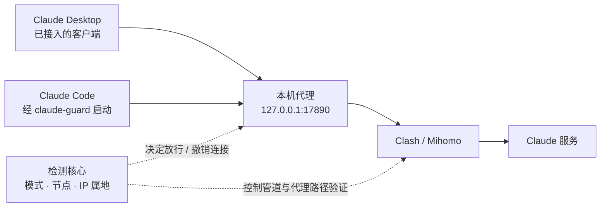

<div align="center">
  
  <h1>Melian</h1>
  <p><strong>一个小小的灵动岛，守住 Claude 的网络连接。</strong></p>
  <p>原生桌面 · 网络检查 · 静音可见提醒 · 登录自启</p>
  <p>
    
    
    
    
  </p>
  <p>
    <a href="#功能">功能</a> ·
    <a href="#安装">安装</a> ·
    <a href="#更新">更新</a> ·
    <a href="#快速开始">快速开始</a> ·
    <a href="rust/README.zh-CN.md">使用指南</a> ·
    <a href="#架构">架构</a> ·
    <a href="#开发">开发</a> ·
    <a href="#参与贡献">参与贡献</a>
  </p>
</div>


Melian 是为 Windows 上的 Claude Desktop 和 Claude Code 制作的网络守卫。平时只留一个黑色胶囊；点击展开启动入口和自启开关，网络异常时显示原因，并中断已接入客户端的受保护连接。

它配合 Clash 工作：只有**全局模式、明确的代理节点、实际代理 IP 属地为美国**同时满足时才放行。Melian 本身不提供代理线路，也不改变账号地区。

> [!IMPORTANT]
> **本文介绍本地 2.2 开发版，程序改动尚未合入；仓库已提交的程序源码仍为 2.1。** 2.2 的网页版保护暂时停用：先前的自动接入方案可能在关闭 VPN 后影响其他网站，包括校园网认证。本地开发版已关闭该入口，普通 Edge / Chrome 页面不受保护；旧版扩展也不作为已验证的替代方案。详见[问题记录](rust/BROWSER-INCIDENT.md)。

## 功能

<table>
  <tr>
    <td width="33%"><strong>一个胶囊，按需展开</strong><br /><br />正常时只显示状态点与 Melian。支持拖动、置顶和位置记忆；常驻显示不抢键盘焦点。</td>
    <td width="33%"><strong>Claude Desktop 接入</strong><br /><br />沿用官方客户端和原有登录。接入后，异常时阻止新启动，已打开的窗口保留、受保护网络断开。</td>
    <td width="33%"><strong>Claude Code 专用入口</strong><br /><br />从菜单或 claude-guard 启动，保留工作目录和原始参数。网络异常时保留终端与会话。</td>
  </tr>
  <tr>
    <td><strong>静音时也看得见</strong><br /><br />持续红色状态与「连接受阻」文字，配合自动展开的原因提示。声音可以辅助提醒，视觉提示始终保留。</td>
    <td><strong>检查通过才连接</strong><br /><br />检查 Clash 模式、节点路径和实际 IP 属地。结果失效或检测中断时，拒绝新连接并关闭已有受保护连接。</td>
    <td><strong>登录后自动运行</strong><br /><br />新安装默认开启自启。菜单中一键开关、即时保存；升级保留已有选择，无需单独的设置窗口。</td>
  </tr>
</table>

**日常操作放在小面板里，诊断信息按需展开。** 节点选择交给 Clash；遇到异常时，Melian 提供对应的处理按钮。

绿色表示网络检查通过。具体客户端是否已接入，要看该入口的状态；它不代表整台电脑或所有浏览器都已受保护。

## 安装

**平台：Windows 11 x64。** 运行时使用 Windows 自带组件，无需额外安装 .NET、WebView 或 Rust。网络检查需要已安装的 Clash / Mihomo 提供 `verge-mihomo` 控制管道。

当前仓库尚未发布 GitHub Release。以下安装与使用说明面向本地 2.2 开发版；仓库内的 2.0 / 2.1 历史产物不代表此版本。当前 `main` 源码可按[开发说明](#开发)构建 2.1，产物仍使用旧名称 `ClaudeGuard.Setup.exe`。

1. 运行 **Melian.Setup.exe**，按提示完成当前用户安装。
2. 启动 Clash，切换到全局模式并选择合适的美国节点，等待 Melian 检查。
3. 单击胶囊，从 **Claude 桌面** 或 **Claude Code** 进入。

安装器创建桌面与开始菜单的 **Melian** 快捷方式。退出后，双击快捷方式或在开始菜单搜索 **Melian** 即可重新打开。

新安装默认**开启登录自启、关闭提示音**。自启可直接在下拉菜单中关闭；「开机自启」指当前用户登录 Windows 后启动。

## 更新

运行新版本的安装器即可升级。目前没有应用内更新检查或自动下载。

升级保留自启选择、声音偏好、首选恢复节点、Claude 路径和窗口位置。安装器先检查新版，再替换 Melian 及其桥接程序；保留配置备份，失败时回退，不结束浏览器、终端或 Claude 子进程。

<details>
<summary><strong>安装位置与卸载</strong></summary>

| 内容 | 位置或操作 |
| --- | --- |
| 安装目录 | `%LOCALAPPDATA%\Programs\ClaudeGuard` |
| 配置与日志 | 通常为 `%APPDATA%\ClaudeGuard`；实际目录以安装目录的 `data-root.txt` 为准 |
| 卸载 | Windows「设置 → 应用 → 已安装的应用 → Melian」，或 `Melian.Setup.exe --uninstall` |

Melian 原名 Claude 网络守卫。安装目录、程序内部名称及 `claude-guard` 命令沿用旧名，以兼容已有配置。

卸载清理本应用的自启、快捷方式、PATH 和注册项，并移除仍归本应用所有的代理配置。重启 Claude Desktop 后恢复其原代理来源；若曾手动安装配套扩展，还需在浏览器中移除。用户配置、日志和历史回退归档会保留。

</details>

## 快速开始

### 看状态，按需操作

| 状态 | 含义 | 操作 |
| --- | --- | --- |
| 绿色 | 网络检查通过 | 使用已接入的 Claude 入口 |
| 黄色 | 正在检查 | 等待验证完成，期间不放行 |
| 红色 · 连接受阻 | 当前网络不满足条件 | 点击查看原因，按提示启动 Clash、恢复代理或重新检查 |

单击展开；点击外部或按 **Esc** 收起。拖动胶囊调整位置，使用 **Tab / 方向键** 移动焦点，**Enter / 空格** 执行操作。

### Claude Desktop

使用官方 Windows MSIX 客户端，版本 **1.44121.1 或更新**。首次接入前，从 Claude 的托盘菜单完全退出客户端，再点击 **Claude 桌面**。如系统要求，完成一次代理配置授权；之后继续使用原账号和登录状态。

接入后，从原来的 Claude 快捷方式启动也会使用固定代理。Melian 运行期间，网络异常会阻止新启动；已经打开的会话保留窗口，受保护连接断开。查看详情可区分「已配置」与观察到实际连接后的「已连接守卫」。

### Claude Code

点击 **Claude Code**，或安装后新开终端运行：

```powershell
claude-guard
claude-guard --cwd "D:\Projects\my-app" -- --resume
```

Melian 只为该入口启动的进程设置代理，原始参数分别传递。已有会话、直接运行 `claude`、后台任务、WSL 和 SSH 远端不在这一入口的保护范围。

### 遇到异常

网络正常运行后出现持续异常，胶囊自动展开原因，并保留红色文字直到恢复。电脑静音也能看见。面板提供一个当前可用的处理按钮；恢复代理时，先阻断连接，再切换并重新验证。

退出 Melian 后，已接入的受保护连接会失败。重新打开 Melian 并等待检查通过后可恢复连接；若要移除接入，请使用卸载流程。

完整操作、代理范围、声音设置与自启排查见[中文使用指南](rust/README.zh-CN.md)。

## 架构



UI 负责呈现状态与接收操作；检测核心负责验证，本机代理负责放行和断开连接。默认拒绝连接，HTTPS 流量不解密。

| 模块 | 技术 | 职责 |
| --- | --- | --- |
| `desktop` | Rust · Win32 · Direct2D / DirectWrite / DirectComposition | 胶囊、动画、托盘、键盘与辅助功能 |
| `core` | Rust · Tokio | Mihomo 检测、状态租约、HTTP / CONNECT 代理、隧道撤销 |
| `platform` | Rust · Windows API | 自启、进程识别、Desktop 接入、当前用户 IPC |
| `protocol` | Rust · Serde | 设置、状态、请求与旧协议兼容 |
| `cli` | Rust | Claude Code 启动器、命令操作、Native Messaging 桥接 |
| `setup` | Rust | 安装、升级、备份回退与卸载 |
| `extension` | JavaScript · Manifest V3 | 保留的浏览器扩展实现；当前不作为已验证的网页保护方案 |

<details>
<summary><strong>检测机制与仓库结构</strong></summary>

- 每秒通过 `verge-mihomo` 读取模式、嵌套策略组与实际节点；直连、负载均衡或路径不明确时拒绝放行。
- 每 30 秒通过实际代理向 `api.country.is` 查询 IP 属地，结果有效期 45 秒。非美国、超时、无结果或过期均阻断。
- 单调时钟租约与独立看门狗防止检测任务失联后继续放行；节点、配置、网络变化或睡眠恢复时撤销旧检测结果和现有隧道。
- 代理固定监听 `127.0.0.1:17890`。端口冲突明确报错，不自动换端口；模式、节点变化存在约 1～2 秒检测窗口。

```text
rust/crates/             六个 Rust workspace 模块
rust/build.ps1           测试、发布构建与安装器生成
rust/package.ps1         整理安装包、源码、扩展与校验值
rust/README.zh-CN.md     随安装包交付的中文使用指南
rust/BROWSER-INCIDENT.md 网页接入问题与停用记录
extension/              浏览器扩展兼容源码
tests/extension-tests/  扩展测试
docs/                   README 图形资源
release/                历史交付及本地产物
```

旧 .NET 实现保留为本地回退归档，不进入 Rust 正式构建。

</details>

## 开发

### 环境

Windows 11 x64、Rust stable 的 MSVC 工具链、MSVC x64 构建工具、Windows SDK，以及用于扩展测试的 Node.js。请在 Visual Studio 的 **x64 Native Tools / Developer PowerShell** 中构建。

### 构建

```powershell
git clone https://github.com/JJchess/Melian.git
cd Melian
.\build.ps1
```

构建脚本运行 Rust 与扩展测试，并检查安装器内嵌载荷。当前 `main` 的 2.1 源码生成 **`rust/dist/ClaudeGuard.Setup.exe`**；本地 2.2 开发版生成 **`rust/dist/Melian.Setup.exe`**。C 运行库静态链接，安装端不需要开发工具链。

需要整理交付文件时，再运行：

```powershell
.\rust\package.ps1
```

当前 `main` 输出位于 `release/ClaudeGuard-2.1.0/`；本地 2.2 开发版输出位于 `release/Melian-2.2.0/`。两者均整理安装器、源码、扩展归档、中文说明、验收记录和 SHA-256 校验文件。生成归档不代表网页功能已恢复或版本已发布。

### 检查

```powershell
cargo test --manifest-path rust/Cargo.toml --workspace --locked
node tests/extension-tests/run.mjs
```

最近一次本机构建通过 **71 项 Rust 测试、16 项扩展测试**，记录于[当前开发版问题记录](rust/BROWSER-INCIDENT.md)。这些测试不等于实机网络场景全部验收通过。

已有 Desktop 连接断开、规则模式拦截等实机记录见[验收文档](rust/VALIDATION.md)。**新自启方案的真实重启登录、校园网复测、物理多屏与睡眠恢复、内置 Code / Cowork 实际任务仍待验证。** 旧版浏览器隔离测试不能作为当前网页方案已完成的依据。

## 数据与权限

- **本地保存。** 设置、日志和接入记录保存在当前用户目录；升级保留已有数据。
- **连接透传。** 不解密 HTTPS，不记录会话内容、密钥或订阅；IP 属地检查会通过代理向 `country.is` 发出请求。
- **权限按需使用。** 常驻应用以普通用户权限运行；Desktop 首次配置或卸载清理遇到受限策略目录时，系统会请求一次 UAC 授权。
- **范围明确。** 保护已接入的代理流量。自动更新、外部工具、远程任务及不遵循代理的程序不在该范围；当前普通浏览器网页也不在保护范围。

## 参与贡献

欢迎通过 [Issues](https://github.com/JJchess/Melian/issues) 提交问题，或提交范围清晰的 Pull Request。修改网络与代理逻辑时，请覆盖默认拒绝、旧验证失效、已有隧道关闭，以及守卫退出后的行为。

报告问题请附上 Windows / Melian / Clash 版本、使用的入口、复现步骤和脱敏后的错误信息。涉及其他网站时，请说明网络类型、系统代理开关和 Melian 是否运行；不要上传密钥、订阅链接或会话内容。

## 致谢

原生界面与系统集成基于 [windows-rs](https://github.com/microsoft/windows-rs)，异步网络使用 [Tokio](https://github.com/tokio-rs/tokio)，代理控制对接 [Mihomo](https://github.com/MetaCubeX/mihomo)。README 的内容组织参考了 [CCBaga](https://github.com/liseami/CCBaga)，图形资源为本项目制作。

<div align="center">
  <sub>Melian 是独立项目，与 Anthropic 无隶属关系。</sub>
</div>
